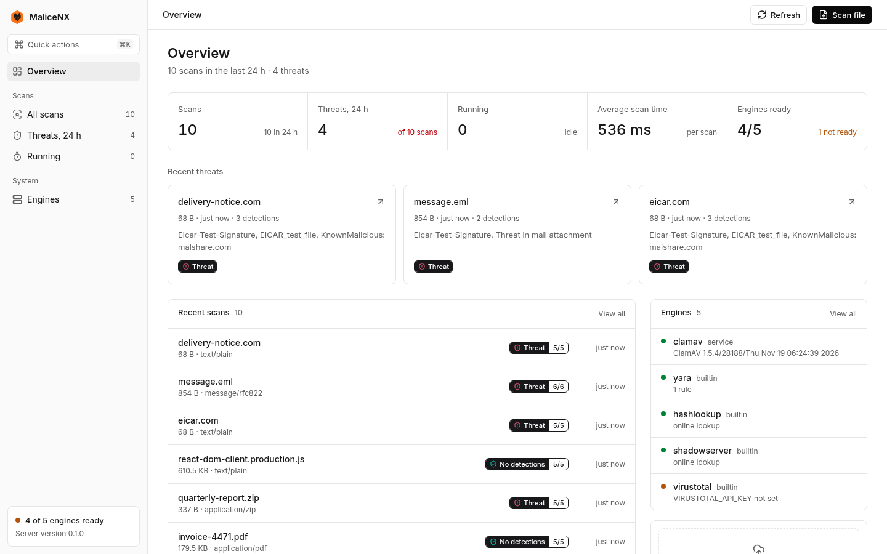
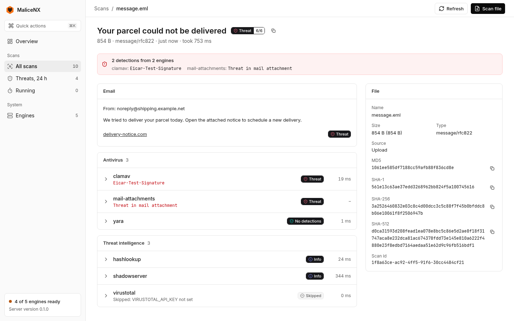

# MaliceNX

A self-hosted malware scanner that runs every file through several engines at once. Upload a file or send an email, and ClamAV, YARA-X and three hash lookups check it in parallel. The results end up in one dashboard with full-text search.

Files stay on your server. Only their hashes go to the lookup services.



## Engines

| Engine | Runs as | What it checks |
|---|---|---|
| clamav | own container (clamd) | ClamAV signatures, kept current by freshclam |
| yara | inside the server | YARA-X with every `.yar` and `.yara` file in `rules/` |
| hashlookup | inside the server | [CIRCL hashlookup](https://hashlookup.circl.lu/) by SHA-256, which includes NSRL |
| shadowserver | inside the server | Shadowserver list of known software, by MD5 |
| virustotal | inside the server | VirusTotal report by SHA-256, needs `VIRUSTOTAL_API_KEY` |

A scan ends as one of three verdicts:

- **Threat.** At least one engine flagged the file.
- **No detections.** No engine flagged the file, and ClamAV and YARA both finished.
- **Incomplete.** No engine flagged the file, but ClamAV or YARA failed, was skipped, or a restart interrupted the scan. MaliceNX never reports such a scan as clean. A detection stays a threat even if another engine fails.

A hash lookup that is down does not make a scan incomplete. A match in a list of known software counts as information, not as proof that a file is clean. The EICAR test file, for example, is in NSRL.

`rules/` ships with a single EICAR rule. Drop your own rule sets into that folder and restart the server. Files that YARA-X cannot compile are skipped with a warning.



## Quick start

You need Docker with Compose v2, or Podman with `podman compose`. The image build compiles the Rust server and needs a few GB of RAM.

```bash
git clone https://github.com/bl4ckh4nd/malicenx.git
cd malicenx
docker compose up -d --build
```

Open http://127.0.0.1:3993. On the first start clamd loads its signatures, which takes up to two minutes. The server waits for it.

To see a detection, scan the EICAR test file:

```bash
printf '%s' 'X5O!P%@AP[4\PZX54(P^)7CC)7}$EICAR-STANDARD-ANTIVIRUS-TEST-FILE!$H+H*' > eicar.com
curl -F file=@eicar.com http://127.0.0.1:3993/api/scans
```

The response contains the report path. Open it in the browser, or poll `GET /api/scans/<id>` until `status` is `done`.

## Configuration

Compose reads settings from a `.env` file next to `compose.yaml`. All of them are optional.

| Variable | Default | Meaning |
|---|---|---|
| `MALICENX_PORT` | `3993` | Host port for the UI and API |
| `MALICENX_TOKEN` | none | Bearer token for the UI and API. Without it there is no authentication. |
| `VIRUSTOTAL_API_KEY` | none | Turns on the VirusTotal lookup |
| `MALICENX_MAX_SCANS` | `4` | Scans that run at the same time |
| `MALICENX_MAX_ACCEPTED` | `16` | Uploads, queued and running submissions combined. Beyond that the API answers 503. |
| `MALICENX_SAMPLE_RETENTION_HOURS` | keep forever | Deletes stored original files after this many hours (1 to 87600). Reports and mail previews stay. |
| `MALICENX_INGEST_TOKENS` | none | Submit-only tokens, one per integration, as JSON: `{"mailserver": "<token>"}`. Requires `MALICENX_TOKEN`. |
| `MALICENX_INGEST_TOKEN` | none | A single submit-only token, listed as the integration `integration` |

Submit-only tokens can post files and mail but cannot read reports. Give each integration its own.

### Notifications

| Variable | Meaning |
|---|---|
| `MALICENX_WEBHOOK_URL` | Receives a signed `scan.completed` event for each new submission. HTTPS, or HTTP on localhost. |
| `MALICENX_WEBHOOK_SECRET` | HMAC-SHA256 key for the signature, at least 32 bytes |
| `MALICENX_SMTP_HOST` | Relay for mail reports. The connection always uses STARTTLS. |
| `MALICENX_SMTP_PORT` | Relay port, default `587` |
| `MALICENX_SMTP_USER`, `MALICENX_SMTP_PASSWORD` | Relay login |
| `MALICENX_SMTP_FROM` | Sender address of the reports |
| `MALICENX_SMTP_TO` | Internal mailbox that gets a report link for every scanned mail |
| `MALICENX_SMTP_CA_FILE` | Container path of a PEM file for a relay with a private CA. Mount the file read-only. |
| `MALICENX_PUBLIC_URL` | URL of the UI, used in report links. Required when SMTP is set. |

Reports only go to `MALICENX_SMTP_TO`. MaliceNX never writes to sender addresses taken from submitted mail. Failed deliveries are retried from a queue in SQLite, five attempts per event. The signature scheme is in [docs/api.md](docs/api.md).

## Scanning email

MaliceNX scans the raw message and every attachment, including attachments of forwarded messages. The report shows sender, subject and body as plain text and links each attachment to its own scan. Limits are 25 MiB per message, 32 attachments and 50 MiB of decoded attachment data.

There are four ways in:

1. Upload a `.eml` file in the browser.
2. `POST /api/mail` with `Content-Type: message/rfc822`.
3. Pipe messages from an existing mail server into `scripts/submit-mail.sh`. It reads one message from stdin and needs `MALICENX_URL` and `MALICENX_INGEST_TOKEN`.
4. Send mail to the SMTP intake on `127.0.0.1:2525`. It accepts one recipient, `scan@malicenx.local` by default, and answers with the report path.

When users forward suspicious mail, ask them to forward it as an attachment. That keeps the original headers and attachments.

| Variable | Default | Meaning |
|---|---|---|
| `MALICENX_SMTP_INTAKE_PORT` | `2525` | Host port of the SMTP intake |
| `MALICENX_SMTP_INTAKE_RECIPIENT` | `scan@malicenx.local` | The only envelope recipient the intake accepts |
| `MALICENX_SMTP_LISTEN` | set by Compose | Listen address of the intake. Outside Compose the intake is off unless you set it. |

The SMTP intake speaks plain SMTP without authentication and is meant for trusted local clients.

### Public scan address

For an address on your own domain, `compose.mail-gateway.yaml` adds a Postfix front end with STARTTLS. It accepts only the configured scan address, rejects every other recipient during the SMTP dialogue and hands the message to MaliceNX over a private network.

1. Put `MALICENX_GATEWAY_HOSTNAME`, `MALICENX_SMTP_INTAKE_RECIPIENT`, `MALICENX_TOKEN` and `MALICENX_GATEWAY_CERT_DIR` into `.env`. The certificate folder holds `fullchain.pem` and `privkey.pem`.
2. Start both files together:
   ```bash
   docker compose -f compose.yaml -f compose.mail-gateway.yaml up -d --build
   ```
   The gateway listens on `127.0.0.1:2526`.
3. To receive mail from the internet, set `MALICENX_GATEWAY_BIND` to the public IPv4 address and `MALICENX_GATEWAY_PORT=25`. Add an MX record for the recipient domain and an A record for the gateway hostname, and open TCP 25 in the firewall.

STARTTLS on the gateway is opportunistic, so servers without TLS can still deliver. Publish the UI separately behind an HTTPS reverse proxy.

## Security notes

- By default Compose binds every port to `127.0.0.1`. Only the mail gateway can listen publicly, through `MALICENX_GATEWAY_BIND`. For remote access to the UI, put a reverse proxy with TLS in front and set `MALICENX_TOKEN`.
- The `data` volume keeps every uploaded file under `samples/<sha256>`, live malware included. Treat backups of it the same way, or set `MALICENX_SAMPLE_RETENTION_HOURS`.
- Hashes leave the host. SHA-256 goes to CIRCL hashlookup and, with a key, to VirusTotal. MD5 goes to Shadowserver over plain HTTP. No engine uploads file contents.
- Once configured, webhooks send the scan ID, SHA-256, verdict, finish time, source, the caller's reference and the report link. Report mail contains the verdict and the report link.
- The server container runs read-only as UID 10001 with all capabilities dropped. Server and clamd talk over an internal network. By default the only outbound traffic is the server's hash lookups and freshclam's signature updates, plus webhooks and report mail once you configure them. Nothing mounts the Docker socket.

Please report vulnerabilities privately through the "Report a vulnerability" button on the repository's Security tab, not in a public issue.

## API

```bash
curl -H "Authorization: Bearer $MALICENX_TOKEN" -F file=@sample.bin http://127.0.0.1:3993/api/scans
# 202 {"id":"...","sha256":"...","name":"sample.bin","report":"/scans/...","status":"running"}

curl -H "Authorization: Bearer $MALICENX_TOKEN" http://127.0.0.1:3993/api/scans/<id>
```

Uploads accept up to 256 MiB. Submissions take optional `Idempotency-Key` and `X-Scan-Reference` headers. The full contract, including search, filters and the webhook signature, is in [docs/api.md](docs/api.md).

## Development

The server is Rust (axum, SQLite, Tantivy, YARA-X). The UI is React with Vite, shadcn/ui and TanStack Query.

```bash
# clamd as a single container
docker run -d --name malicenx-dev-clamd -p 127.0.0.1:3310:3310 docker.io/clamav/clamav:1.5.4

# server on http://127.0.0.1:3993
cd server && MALICENX_RULES=../rules cargo run
```

In a second terminal, from the repository root:

```bash
# UI dev server, proxies /api to :3993
cd web && pnpm install && pnpm dev
```

`VITE_MOCK=1 pnpm dev` runs the UI against the fixtures in `web/dev-fixtures/` without a server. Some fixtures show engines that do not exist yet (pe, exiftool, oletools).

Outside the container the server reads these variables:

| Variable | Default |
|---|---|
| `MALICENX_LISTEN` | `127.0.0.1:3993` |
| `MALICENX_DATA` | `./data` |
| `MALICENX_RULES` | `./rules` |
| `MALICENX_WEB_DIR` | `../web/dist` |
| `CLAMD_ADDR` | `127.0.0.1:3310` |
| `RUST_LOG` | `info` |

A debug build fills about 5 GB in `server/target`. Point `CARGO_TARGET_DIR` elsewhere if disk space is tight.

On SELinux hosts the `./rules` mount needs the `z` option, which `compose.yaml` already sets. Without it YARA loads zero rules and the server logs a warning.

### Tests

```bash
(cd server && cargo test) # store, verdicts, search, rule loading
scripts/smoke.sh          # starts Compose, scans EICAR, checks clamd and YARA flag it
scripts/e2e-upload.sh     # browser journey with playwright-cli: upload, report, search
scripts/e2e-mail.sh       # forwarded mail with nested attachments, idempotent retry
scripts/e2e-smtp.sh       # SMTP intake: recipient filter, size limit, attachment scan
```

The scripts write their evidence (scan JSON, screenshots) to `artifacts/`. Against a server with `MALICENX_TOKEN` set, export the token before running them.

The mail and SMTP tests target `http://127.0.0.1:3993` unless `MALICENX_TEST_URL` says otherwise. `MALICENX_TEST_BROWSER=1` adds the browser check and screenshots to `e2e-mail.sh`. To test the gateway, set `MALICENX_SMTP_INTAKE_PORT` to its published port, `MALICENX_TEST_SMTP_RECIPIENT` to the scan address and `MALICENX_TEST_SMTP_CA` to the CA of a test certificate, then run `e2e-smtp.sh`.

## Project layout

```
server/        Rust server: API, engines, SQLite store, search, SMTP intake
web/           React UI, built into the server image
rules/         YARA rules loaded at startup
mail-gateway/  optional Postfix front end for a public scan address
scripts/       smoke and end-to-end tests, mail server pipe
docs/          API contract and README images
```

## Roadmap

- PE analysis inside the server
- capa, oletools and a PDF analyzer as separate services next to clamd
- A script that pulls larger YARA rule sets into `rules/`

## Credits

The idea comes from [Malice](https://github.com/maliceio/malice) and its rebuild [rufftruffles/malice](https://github.com/rufftruffles/malice). MaliceNX shares no code with either and is not affiliated with them.

## License

MIT, see [LICENSE](LICENSE). ClamAV runs from its official, unmodified image under its own license (GPL-2.0).
